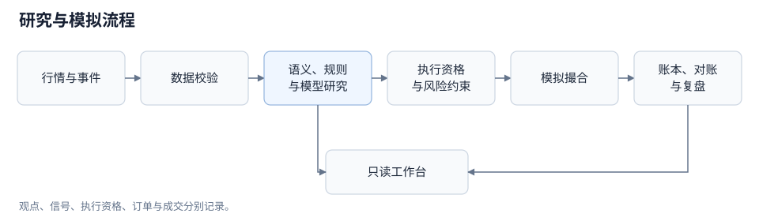
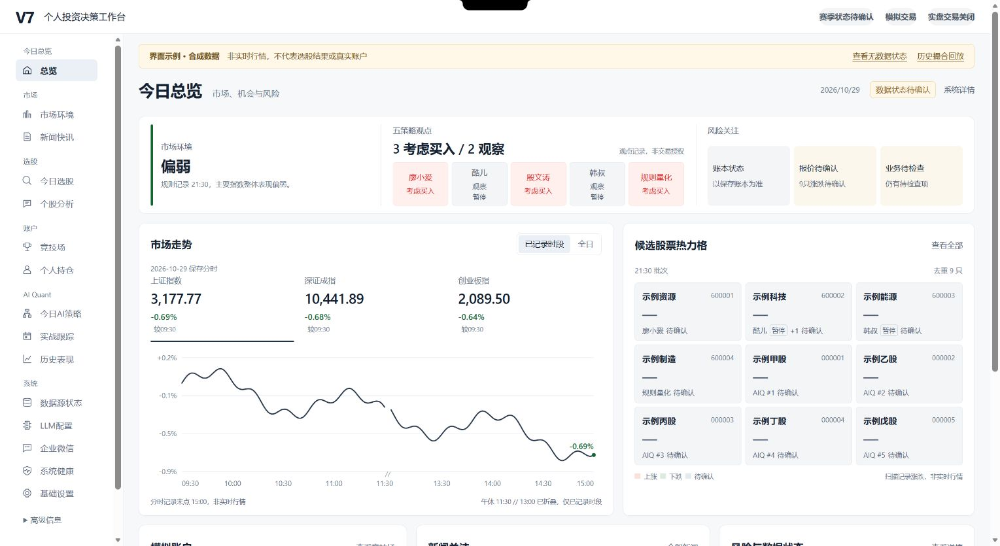
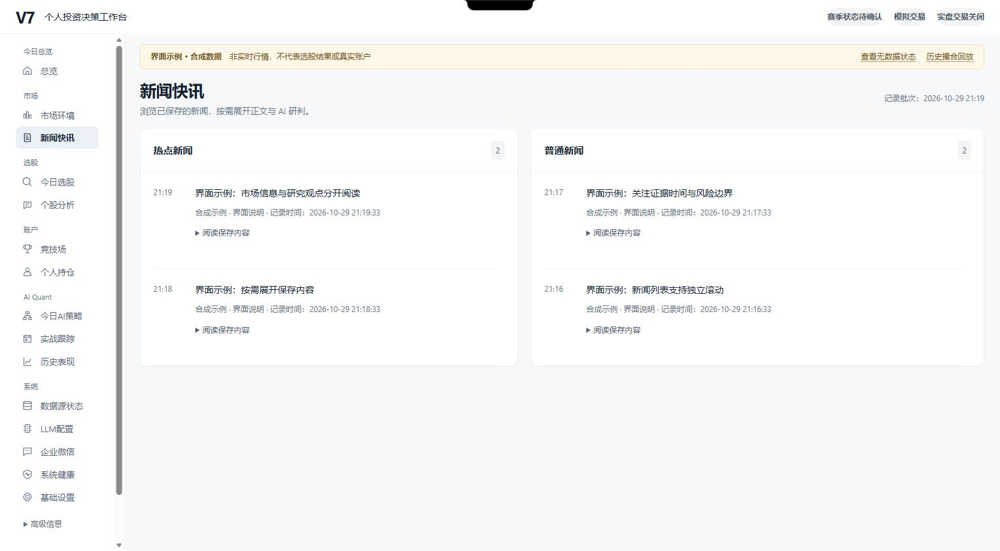
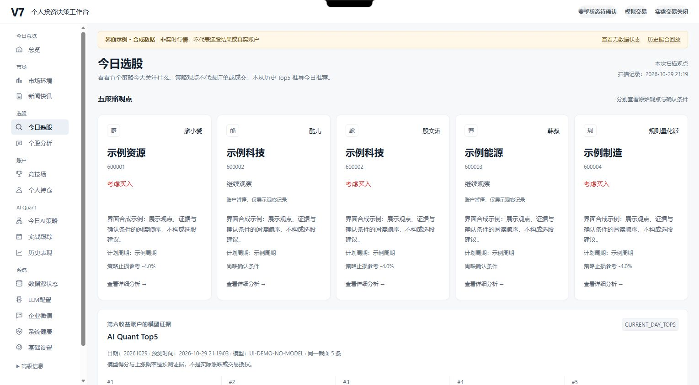

# V7 · A 股研究与模拟交易工作台

V7 将行情、新闻事件、策略规则、量化研究与模拟账户整合为可追溯的研究流程。系统使用 LLM 处理新闻与事件语义，使用确定性代码完成数据准入、交易约束、撮合、费用和账本核对。

公开版本提供无凭证启动的交互界面与历史撮合回放。实时数据采集、LLM 连接和正式模拟赛季需要独立配置与运行验证。

[快速开始](#快速开始) · [系统组成](#系统组成) · [界面](#界面) · [文档](docs/README.md) · [已知限制](docs/KNOWN_ISSUES.md)

## 系统组成

| 模块 | 职责 |
|---|---|
| 市场与事件 | 聚合市场环境、新闻、事件与个股线索，记录来源和数据时间 |
| 策略契约 | 定义候选范围、触发条件、仓位、退出规则和必要证据，输出结构化决策 |
| 量化研究 | 构建标签与特征，通过排序模型、校准与计划模块形成独立 AI Quant 研究链路 |
| 数据准入 | 检查证券资格、时效、完整性及运行状态，明确区分可用、过期和缺失数据 |
| 模拟执行 | 在交易时段、T+1、整手、报价与费用等约束下计算假设成交 |
| 账本与复盘 | 保存订单、成交和账户记录，通过对账生成展示状态与研究报告 |

研究观点、策略信号、执行资格、订单和成交是不同的业务对象。系统包含五个规则/角色收益账户、一个独立 AI Quant 收益账户，以及不交易、不参与收益排名的风险观察角色。当前韩叔与 Cool 策略保持停用，详见[功能说明](docs/SYSTEM_OVERVIEW.md)。



架构图表示逻辑职责。公开入口运行独立的只读预览，不启动原调度器或正式模拟赛季。[架构与数据流](docs/ARCHITECTURE.md)

## 快速开始

已验证的运行环境为 **Windows、64 位 Python 3.13**。在仓库根目录执行：

```powershell
py -3.13 -m venv .venv
.\.venv\Scripts\python.exe -m pip install -r requirements.txt
.\.venv\Scripts\python.exe -m scripts.public_preview
```

没有 Python Launcher 时，用已安装 Python 3.13 解释器的完整路径代替 `py -3.13`。默认端口为 8020；端口占用时可追加 `--port 8021`。macOS/Linux 可使用 `python3.13` 与 `.venv/bin/python` 执行对应命令，尚未提供同等范围的平台验证。

| 入口 | 数据与行为 |
|---|---|
| [交互界面](http://127.0.0.1:8020/demo) | 使用当前工作台组件与明确标注的合成数据，不调用行情源或 LLM |
| [历史回放](http://127.0.0.1:8020/replay) | 使用三条历史价格与预设假设订单，运行撮合、T+1 限制、费用与对账 |
| [无数据工作台](http://127.0.0.1:8020/v7) | 保留缺失数据和不可用状态，不填充生产账户或模拟实时行情 |

公开服务默认绑定本机回环地址，只接受 GET/HEAD。启动前屏蔽私有配置文件及继承的 LLM/Webhook 凭证。界面合成数据与历史回放分属独立接口，均不初始化正式赛季或累计 Forward 天数。

命令行核对历史回放：

```powershell
.\.venv\Scripts\python.exe -m scripts.public_preview --check
.\.venv\Scripts\python.exe -m scripts.public_demo --json
```

回放核心使用 Python 标准库，网页依赖由 `requirements.txt` 提供。

## 界面

当前界面为 v3-r3，涵盖市场信息、候选研究、账户、AI 策略、数据及系统管理页面。以下截图来自公开合成示例，页面保留数据性质标记。



<details>
<summary>新闻与策略候选</summary>





</details>

界面中的曲线、观点、候选分数和账户指标为组件示例，不能用于评价模型或策略。缺少实际报价证据的候选涨跌显示为待确认。[界面与数据边界](docs/UI_PREVIEW.md)

## 项目结构

```text
scripts/
  datasource/     数据适配、校验与恢复
  pipeline/       新闻处理与任务编排
  analysis/       事件分析、策略合同与复盘
  ai_quant/       标签、特征、模型、计划与运行
  research/       历史研究与实验脚本
  competition/    规则、费用、撮合、账户与账本
  daemon/         调度、运行管理与 API 聚合
  public_*.py     隔离预览与历史回放入口
workbench_v7/     HTML、CSS 与 JavaScript 工作台
config/           规则、日历与配置样例
tests/            公开验收集合与历史测试
docs/             系统、接口、验证与数据说明
```

主要技术组件：Python、FastAPI、SQLite、原生 HTML/CSS/JavaScript；量化研究使用 NumPy、pandas、LightGBM、scikit-learn 与 joblib。后台调度与 Windows 托盘属于可选实时运行栈。

## 依赖与验证

| 文件 | 范围 |
|---|---|
| `requirements.txt` | 公开预览的最小依赖 |
| `constraints-preview.txt` | 已验证预览环境的版本约束 |
| `requirements-dev.txt` | 公开预览、数据适配与恢复的离线测试 |
| `requirements-quant.txt` | 量化研究依赖 |
| `requirements-live.txt` | 实时数据、调度、LLM 与 Windows 集成依赖 |

```powershell
.\.venv\Scripts\python.exe -m pip install -r requirements-dev.txt
.\.venv\Scripts\python.exe -m pytest -q
.\.venv\Scripts\python.exe -B tools/check_public_release.py --git
```

默认测试覆盖公开入口、隔离历史回放、只读边界、数据适配与交易恢复回归。CI 另外检查发布路径、完整 Git 历史中的敏感信息及历史回放。历史测试中仍有依赖旧赛季或未分发材料的用例，默认集合不代表全部历史测试。[验证范围](docs/VALIDATION.md)

## 文档

| 文档 | 内容 |
|---|---|
| [系统与功能](docs/SYSTEM_OVERVIEW.md) | 使用流程、功能模块、页面与状态语义 |
| [架构设计](docs/ARCHITECTURE.md) | 模块职责、数据流、关键对象和运行边界 |
| [API 说明](docs/API.md) | V7 聚合接口、响应结构与预览接口 |
| [验证说明](docs/VALIDATION.md) | 工程、AI 质量、研究与运行验证的范围 |
| [维护计划](docs/ROADMAP.md) | 规则一致性、证据组织、评测和运行维护 |
| [已知限制](docs/KNOWN_ISSUES.md) | 当前功能及环境限制 |
| [历史样本](docs/DEMO_PROVENANCE.md) | 数据来源、假设订单及撮合代理 |
| [公开范围](docs/PUBLIC_RELEASE_NOTES.md) | 发布内容与数据隔离 |
| [隐私检查](docs/PRIVACY.md) | 发布检查与敏感信息处理 |

## 使用范围与许可

系统用于研究与模拟，不连接实盘下单。新闻原文引用校验不等于推论正确，模型分数与自报置信度也不等于经验证的获利概率。公开版本尚无经过合格 Forward 验证的盈利结论。

仓库不分发生产数据库、账户账本、持仓、运行状态、凭证、原始音频/转录或完整新闻语料。角色名称属于历史接口标签，不表示相关人物参与或背书。

代码、公开模型资源及第三方依赖的许可范围需分别确认；当前未授予整个目录统一的再分发许可。
