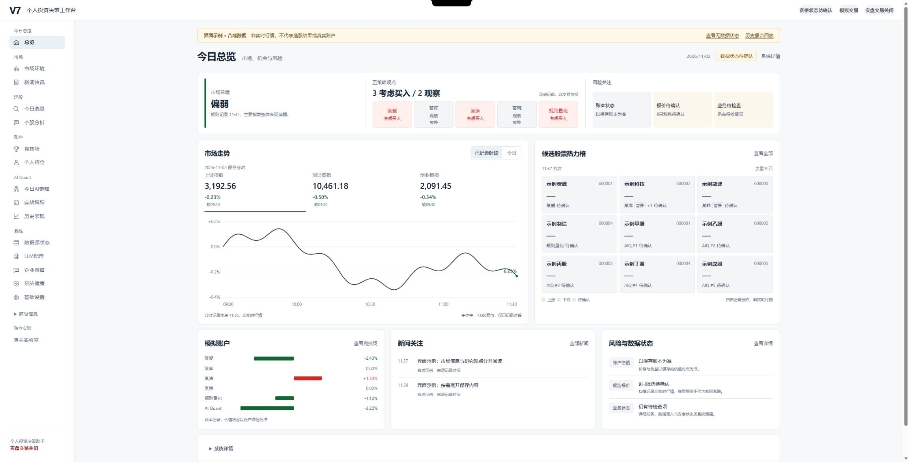
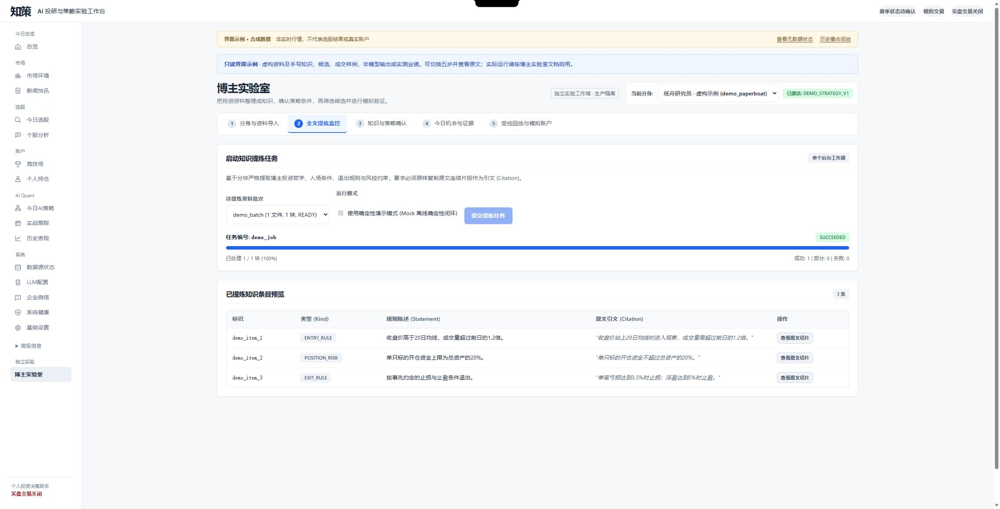
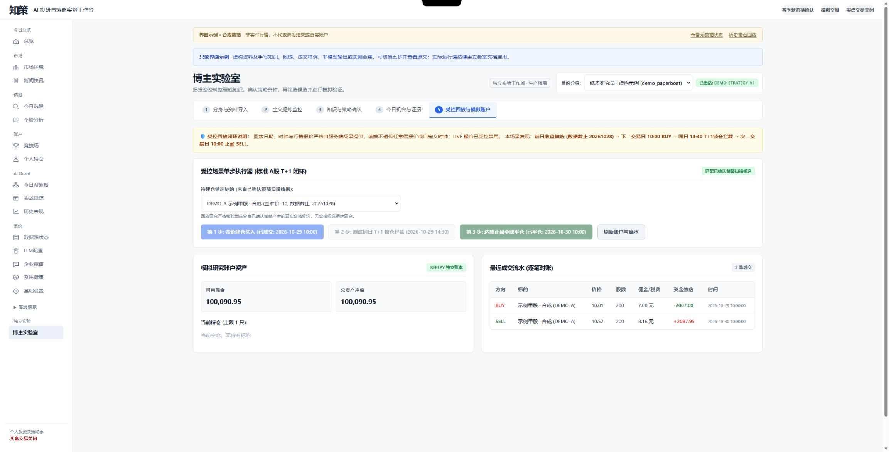
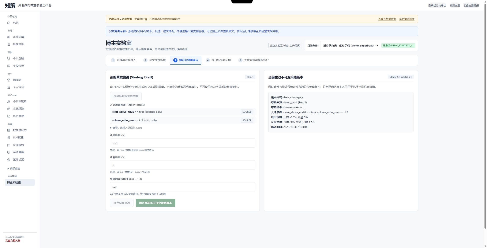
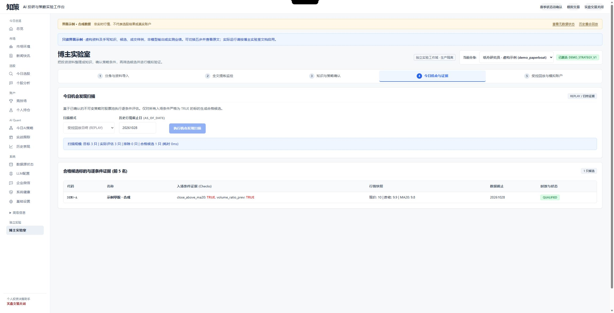
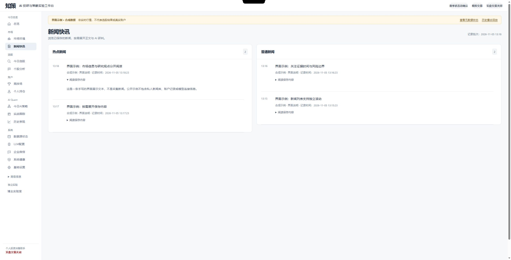
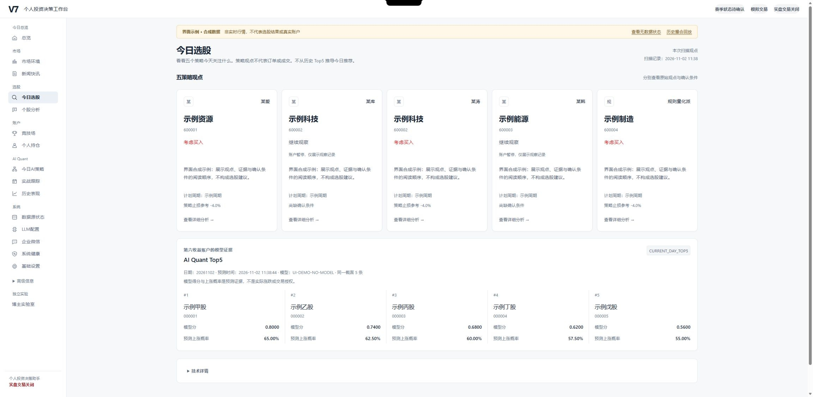

# 知策 · AI 投研与策略实验工作台

**汇集市场信息，整理投资知识，验证研究策略。**

知策面向 A 股研究，把行情、新闻、多视角研判与模拟账户放在一个工作台。通过**博主实验室**，还可以导入投资文稿，整理带原文依据的知识，确认策略规则，再筛选候选并进行模拟验证。

[功能概览](#可以用知策做什么) · [博主实验室](#博主实验室从资料到策略实验) · [开始体验](#开始体验) · [功能指南](docs/SYSTEM_OVERVIEW.md) · [技术文档](docs/README.md)



> 图片和默认交互界面使用明确标注的合成数据与化名。无需凭证即可浏览；实际知识提炼需要模型连接，实际候选筛选需要合格行情数据。

## 可以用知策做什么

| 想完成的任务 | 对应功能 | 可以看到的结果 |
|---|---|---|
| 了解市场与当日关注事项 | 总览、市场环境、新闻快讯 | 走势、重要信息、来源与时间，以及数据缺失提示 |
| 比较不同策略的判断 | 多视角新闻研判、策略候选、个股分析 | 关注标的、判断依据、已触发和未满足的条件 |
| 把投资资料变成可试验的方法 | 博主实验室 | 知识与原文引用、待确认参数、策略版本、候选与独立模拟账户 |
| 跟踪模拟执行与研究结果 | 竞技场、AI 策略跟踪、报告审计 | 持仓、成交、费用、账户变化和研究记录 |

新闻观点用于解释信息，规则策略与 AI Quant 分别提供条件筛选和模型排序。候选、计划、订单与成交分别展示，便于逐步核对判断与执行结果。[完整功能指南](docs/SYSTEM_OVERVIEW.md)

## 博主实验室：从资料到策略实验

将分散的投资文稿整理为有依据的知识和可确认的规则，让研究方法能够被检查、筛选和模拟验证。

**创建分身 → 导入资料 → 提炼知识与核对原文 → 人工确认策略 → 筛选候选 → 模拟验证**

| 步骤 | 可以做什么 | 得到什么 |
|---|---|---|
| 分身与资料 | 新增研究分身，导入 TXT、Markdown、DOCX 文稿 | 按分身隔离的资料批次、文件与文本分块 |
| 知识提炼 | 提炼原则、入场/退出条件、仓位纪律与疑问项 | 分类知识、处理进度、可展开的原文切片 |
| 策略确认 | 从知识生成有限规则草案，补充未明确参数 | 经人工确认并锁定的策略版本 |
| 机会筛选 | 选择历史截止日，按已确认条件评估股票池 | 候选、逐项条件证据与数据截止时间 |
| 模拟验证 | 用候选进入受控回放，查看买入、T+1 拦截和卖出 | 独立实验账户、持仓与逐笔成交费用 |

**知识保留原文依据，规则中的空缺由人确认。**



**在独立实验账户中查看模拟流程与成交记录。**



<details>
<summary>查看策略确认与候选证据界面</summary>





</details>

以上实验室图片为虚构“纸舟研究员”的**手写界面样例**；知识、候选及成交均为合成展示，未调用模型或执行真实扫描。它们说明操作与结果的组织方式，不用于证明提炼质量或策略收益。

当前实验链路支持有限日线规则与受控回放；复杂或不明确的投资思想保留为待确认项。实际运行方式与边界见[博主实验室指南](docs/BLOGGER_LAB.md)。

## 市场研究与策略跟踪

将市场走势、新闻来源、策略判断和账户结果放在相邻的工作流中，减少在资料与执行记录之间反复查找。

<details>
<summary>查看新闻研判与策略候选界面</summary>





</details>

研究过程中可沿着**新闻与事件 → 策略条件 → 候选详情 → 模拟账户 → 复盘记录**逐步查看。数据过期、输入缺失或策略停用时保留相应状态，避免把“无法判断”混同于“没有机会”。

## 开始体验

已验证环境为 **Windows、64 位 Python 3.13**。在仓库根目录执行：

```powershell
py -3.13 -m venv .venv
.\.venv\Scripts\python.exe -m pip install -r requirements.txt
.\.venv\Scripts\python.exe -m scripts.public_preview
```

启动后在本机打开以下地址。仓库未提供在线托管演示。

| 入口 | 适合体验什么 | 是否需要外部配置 |
|---|---|---|
| [工作台界面示例](http://127.0.0.1:8020/demo) | 总览、新闻、候选与账户的交互布局 | 不需要，使用合成数据 |
| [博主实验室界面示例](http://127.0.0.1:8020/demo#page-blogger-lab) | 切换五步流程，查看知识原文、策略、候选与成交样例 | 不需要，只读展示，不运行提炼或交易 |
| [历史撮合回放](http://127.0.0.1:8020/replay) | 三条历史价格上的假设订单、T+1、费用与对账 | 不需要，运行隔离的规则回放 |
| [无数据工作台](http://127.0.0.1:8020/v7) | 查看缺少实际输入时的状态 | 不需要，不填充生产数据 |

端口占用时追加 `--port 8021`。没有 Python Launcher 时，用 Python 3.13 解释器完整路径代替 `py -3.13`。macOS/Linux 可使用 `python3.13` 与 `.venv/bin/python`，尚未完成同等范围的平台验证。

**运行自己的博主实验：**停止上述预览后，在同一终端启用独立实验目录并重新启动：

```powershell
$env:V7_BLOGGER_LAB_ENABLED="1"
$env:V7_BLOGGER_LAB_ROOT="./data/blogger_lab_local"
.\.venv\Scripts\python.exe -m scripts.public_preview
```

打开 [博主实验室工作区](http://127.0.0.1:8020/v7#page-blogger-lab)。注册分身和导入资料可离线操作；公共预览屏蔽模型凭证，真实提炼需按指南启动独立本机实验服务，实际扫描需合格行情输入。配置、示例资料和验证方法见[运行指南](docs/BLOGGER_LAB.md#运行自己的实验)。

公开预览默认只读；启用实验室后，仅本机同源的实验室接口允许研究写入。合成示例始终只读。两种模式均不启动正式调度或正式模拟赛季。

## 技术与开发

知策保留 V7 作为版本与内部接口标识。主要组件为 Python、FastAPI、SQLite 和原生 HTML/CSS/JavaScript；AI Quant 使用 LightGBM 等研究依赖。博主实验室采用**分块结构化提炼、原文引用校验、人工策略确认与确定性规则执行**。

```text
scripts/
  blogger_lab/    分身、导入、知识、策略、扫描与实验模拟盘
  datasource/     数据适配、校验与恢复
  pipeline/      新闻处理与任务编排
  analysis/      事件分析、规则策略与复盘
  ai_quant/      特征、排序模型、计划与跟踪
  competition/   费用、撮合、账户与账本
  daemon/        调度与 API 聚合
  public_*.py    隔离预览、合成样例与历史回放
workbench_v7/    工作台界面
config/         规则、日历与配置样例
tests/          公开验收测试
docs/           功能、架构、接口与验证说明
```

```powershell
.\.venv\Scripts\python.exe -m pip install -r requirements-dev.txt
.\.venv\Scripts\python.exe -m pytest -q
.\.venv\Scripts\python.exe -m scripts.public_preview --check
.\.venv\Scripts\python.exe -B tools/check_public_release.py --git
```

`requirements.txt` 提供最小预览依赖；`requirements-dev.txt` 提供离线检查；量化研究与实时运行依赖分别在 `requirements-quant.txt`、`requirements-live.txt`。测试范围见[验证说明](docs/VALIDATION.md)。

| 文档 | 内容 |
|---|---|
| [系统与功能](docs/SYSTEM_OVERVIEW.md) | 任务、页面、使用流程与结果 |
| [博主实验室](docs/BLOGGER_LAB.md) | 五步操作、输入输出、配置与能力边界 |
| [架构设计](docs/ARCHITECTURE.md) | 模块职责、数据流与隔离方式 |
| [API 说明](docs/API.md) | 聚合接口与预览约定 |
| [界面与数据](docs/UI_PREVIEW.md) | 合成示例、历史回放与实际运行的区别 |
| [文档索引](docs/README.md) | 验证、维护计划、公开范围与隐私检查 |

## 使用范围与许可

系统用于研究与模拟，不连接实盘下单。原文引用不代表推论正确，候选分数不代表获利概率；当前没有经过合格 Forward 验证的盈利结论。

公开仓库不携带生产数据库、真实账户账本、持仓、凭证或私人原始语料。展示角色使用化名或虚构名称，不表示相关人物参与或背书；某韩、某库策略当前保持停用。[已知限制](docs/KNOWN_ISSUES.md)

代码、公开模型资源与第三方依赖的许可需分别确认；当前未授予整个目录统一的再分发许可。
