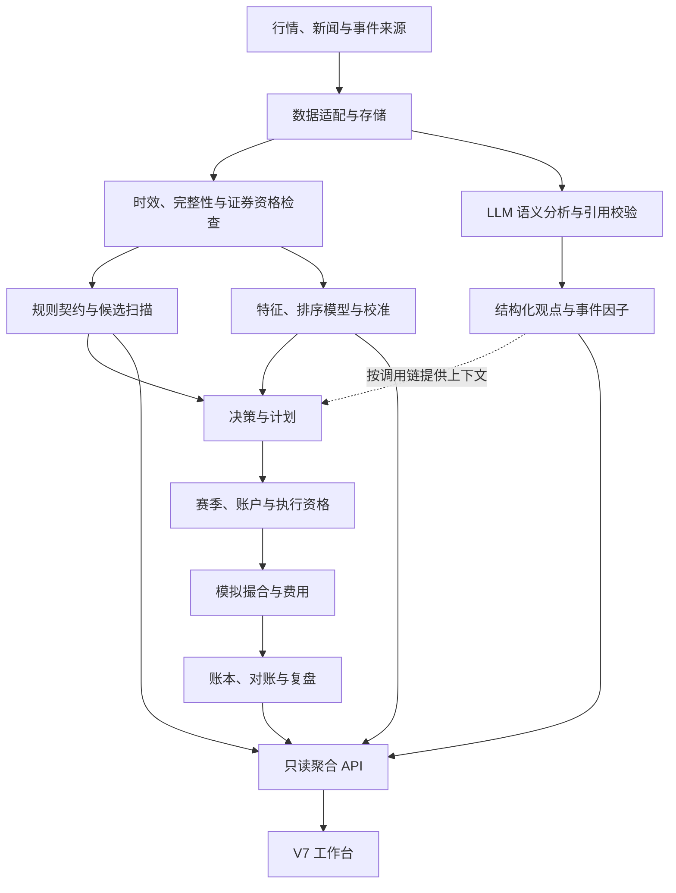

# 架构设计

## 设计原则

系统将数据有效性、语义判断、策略决策、模拟执行和经济记录划分为不同职责。下游消费必须满足其所需的时间、证据和运行条件；展示层读取状态，不生成交易事实。

技术实现以 Python、FastAPI、SQLite、JSON/JSONL 及原生 HTML/CSS/JavaScript 为主。后台调度采用 APScheduler，研究侧包含 LightGBM 排序与校准模块。

## 逻辑分层

该图表示逻辑职责与主要关系，不表示每条事件因子都进入 AI Quant 特征。历史分析模块和 V7 赛季链路存在并存路径。

## 模块职责

| 模块 | 实现位置 | 职责 |
|---|---|---|
| 数据层 | `scripts/datasource/` | 适配行情源、标准化输入、证券资格和完整性校验、历史恢复 |
| 新闻工作流 | `scripts/pipeline/` | 新闻采集、相关性过滤、分发和持久化 |
| 语义分析 | `scripts/analysis/llm_analyst.py`、`event_factors.py` | 结构化观点、原文引用检查、事件因子与有限重试 |
| 策略合同 | `config/skill_contracts_v2.json`、`skill_contracts.py`、`scan_mainboard_picks.py` | 规则、证据、动作、原因和仓位/退出计划；加载器不承担选股 |
| 量化研究 | `scripts/ai_quant/`、`scripts/research/` | 标签、特征、数据集、排序、校准、计划与观察资格 |
| 模拟与账户 | `scripts/competition/`、`ai_quant/forward_runner.py` | 交易限制、费用、撮合、事务记录、对账和持仓退出 |
| API 与展示 | `scripts/daemon/v7_api.py`、`v7_picks.py`、`v7_arena.py`、`workbench_v7/` | 聚合证据并生成只读视图 |
| 运行管理 | `trading_daemon.py`、`watchdog.py`、`config/schedule.yaml` | 定时作业、单实例与运行恢复 |
| 公开预览 | `scripts/public_preview.py`、`public_demo.py`、`public_ui_fixture.py` | 隔离 UI 示例、历史回放及无数据工作台 |

## 分析与决策链路

### 新闻语义

`llm_analyst.py` 将新闻、角色约束和上下文送入一次 LLM 请求，生成六角色观点及事件因子。响应采用 JSON object 模式，经过本地结构处理、枚举及原文片段检查。引用不合格时有限重试；最终无有效观点则弃用。

引用校验只能确认文本来自给定新闻，不能证明新闻真实性、实体映射或推论支撑充分。输出的 `confidence` 是模型自报值，不是经过校准的正确概率。

当前缓存键仅由新闻标题与正文构成；模型、提示词、规则和上下文版本尚未完整绑定。近期教训模块仍读取旧账本路径，不能直接视为已覆盖 V7 正式赛季的完整反馈。[维护计划](ROADMAP.md)

### 规则与机器学习

规则策略通过合同与扫描逻辑生成结构化动作。韩叔/Cool 保持 `NO_SIGNAL`，风险观察角色不建仓。

AI Quant 是独立机器学习链路，包含标签、特征、LightGBM 截面排序、校准、候选与计划。源码包含 Ridge 基线及研究实验脚手架；其存在不代表公开版本已验证预测增益。

标签包含日线入场代理及相应时序偏差，研究报告应记录代理、费用、模型与标签版本。历史代理不能证明实际盘中成交。Forward 合格天数由专门证据门管理。

## 存储与关键对象

SQLite 保存行情、新闻、因子与研究数据；JSON/JSONL 保存运行、赛季、订单及成交等记录。公开仓库不携带生产数据库或正式赛季状态。

| 对象 | 代表字段 | 语义 |
|---|---|---|
| 新闻观点 | `headline, stance, confidence, logic, quote_excerpt, anchor_ok` | 解释及引用检查结果 |
| 事件因子 | `event_type, primary_symbol, impact_side, sentiment, half_life_h` | 文本事件的结构化表示 |
| 策略决策 | `decision_id, participant_id, skill_version, action, candidate_evidence, skill_rules_triggered, skill_rules_failed, evidence_refs` | 决策主体、规则版本与证据 |
| 执行周期 | `entry_status, exit_check_status, history_cutoff` | 分开标识新开仓与持仓退出状态 |
| 赛季与账本 | 身份、订单、成交、现金、持仓和对账记录 | 账户状态的依据，页面为其投影 |

表中字段用于说明对象，不代替完整 Schema。

## 执行与恢复

持仓退出与新开仓使用不同依赖顺序：当前报价和账本安全 → 持仓退出及估值 → 历史输入、模型及新开仓。历史失效只阻断新开仓；报价缺失、T+1、停牌、价格限制和账本安全仍限制退出。

日终恢复按交易日保存采集证据，经过资格、完整性和复权输入校验后发布合格缓存。重试有限且请求预算跨运行累计；失败保留既有合格版本与限制原因。[交易链路恢复](TRADING_RECOVERY.md)

进程存活、作业成功、输入有效和业务可执行分别记录，避免将 HTTP 可达等同于完整业务健康。

## 部署与公开预览

原运行栈包含定时调度、数据连接、模拟赛季和可选通知。安装相应依赖不自动完成其配置或开通。

公开入口为独立只读 FastAPI 进程，默认监听 `127.0.0.1:8020`；不启动调度器、托盘、看门狗或正式赛季。加载配置前屏蔽私有文件及继承凭证，并拒绝写请求。

- `/demo` → `/api/ui-demo/*`：当前组件与手写合成样例，不读取生产账户或运行模型。
- `/replay` → `/api/demo`：历史价格上的假设撮合，临时目录结束后清理。
- `/v7` → `/api/v7/*`：读取可用公开材料；缺失生产数据时保留不可用状态。

历史回放使用独立命名空间和注入时钟，不创建正式赛季、执行实盘或累计 Forward 天数。
