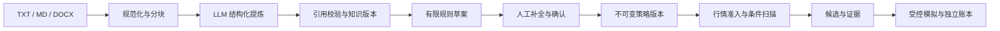

# 博主实验室

博主实验室是知策中的策略研究工作区：将投资文稿整理为带原文引用的知识，经人工确认转成有限规则，再以合格行情筛选候选并在独立账户中模拟验证。

## 五步操作

| 步骤 | 输入 | 操作与输出 | 边界 |
|---|---|---|---|
| 分身与资料 | 分身名称、TXT / MD / DOCX 文稿 | 注册分身，保存文件，规范化文本并分块，生成批次报告 | 按分身隔离；不直接处理视频、音频或扫描 PDF |
| 全文提炼 | 已解析批次、模型连接 | 分块提取七类知识，显示进度、失败项与原文切片 | 原文参数缺失时保留疑问；引用校验不等于内容正确 |
| 策略确认 | 知识版本、人工补充参数 | 生成可编辑草案，确认后锁定策略版本 | 有限规则映射，不是任意自然语言策略编译器 |
| 机会筛选 | 确认版本、股票范围、历史截止日、合格行情 | 按条件检查，返回候选、排除/缺失统计和数据截止 | 当前界面为 REPLAY 日终扫描；缺少行情证据时不出有效候选 |
| 模拟验证 | 候选、服务端回放场景 | BUY → 同日 T+1 拦截 → 下一交易日 SELL；保存账户与费用流水 | 受控验证场景，LIVE 撮合禁用，不证明自然运行收益 |

七类知识为：投资原则、选股偏好、入场条件、退出条件、仓位风险、历史案例、待澄清项。历史案例中的股票不直接作为今日候选。

“分身”指独立的资料、知识、策略与实验账户，不表示模型微调、聊天人格复刻或对原作者投资能力的复现。

## 技术实现与数据流

采用 **LLM 结构化提炼 + 原文引用校验 + 人工策略确认 + 确定性规则执行** 的工作流。当前实现未依赖 LangChain / LangGraph，也未提供向量检索 RAG 或自主规划 Agent。



| 职责 | 源码 |
|---|---|
| 文件解析与分块 | `scripts/blogger_lab/ingest.py` |
| 模型调用、结构与引用校验 | `llm.py`、`knowledge.py`、`schemas.py` |
| 策略草案、人工修订与版本 | `strategy.py` |
| 行情读取与候选筛选 | `market.py`、`scan.py` |
| 模拟撮合与回放场景 | `paper.py`、`replay.py` |
| 存储、服务与任务生命周期 | `store.py`、`service.py`、`runtime.py` |
| API 与原生工作区 | `router.py`、`workbench_v7/js/blogger_lab.js` |

表中未带目录的 Python 文件均位于 `scripts/blogger_lab/`。

## 无配置浏览

按仓库 [README](../README.md#开始体验) 启动后，打开：

[博主实验室界面示例](http://127.0.0.1:8020/demo#page-blogger-lab)

可切换五步，查看虚构“纸舟研究员”的知识引用、策略、候选和成交。全部数据为手写合成样例；注册、上传、提炼、确认、扫描与回放写操作均禁用。此模式不启动实验室运行时，不创建实验数据库，也不调用行情或模型。

样例接口为 `/api/ui-demo/blogger-lab/*`，与实际 `/api/blogger-lab/*` 分开；即使实际实验室已启用，合成界面也只读取样例。

## 运行自己的实验

### 1. 启用独立工作区

在已安装 `requirements.txt` 的仓库根目录执行：

```powershell
$env:V7_BLOGGER_LAB_ENABLED="1"
$env:V7_BLOGGER_LAB_ROOT="./data/blogger_lab_local"
.\.venv\Scripts\python.exe -m scripts.public_preview --port 8020
```

也可将 `.env.example` 复制为 `.env`，填写对应实验室开关和目录后启动。macOS/Linux 可通过环境变量及 `.venv/bin/python` 运行；公开版本以 Windows Python 3.13 为已验证环境。

实际入口是 `scripts.public_preview:create_preview_app`，默认绑定 `127.0.0.1:8020`。打开 [博主实验室工作区](http://127.0.0.1:8020/v7#page-blogger-lab)。此处的操作写入独立实验目录。

### 2. 导入并提炼

创建分身，上传自己的文稿；可先使用公开虚构资料 `examples/blogger_lab/01_synthetic_researcher_sample.txt` 验证导入。该文稿是测试材料，不是第三方原始语料。

公共预览会屏蔽模型凭证，因此以上命令适合导入及 Mock 流程验证；仅填写 `.env` 不会使公共预览调用真实模型。Mock 结果不能当作真实提炼质量证据。

需要真实提炼时，按 `.env.example` 在本地 `.env` 配置 `LLM_API_KEY`、`LLM_BASE_URL`、`LLM_MODEL`，另开终端运行独立实验服务（不启动正式交易调度）：

```powershell
.\.venv\Scripts\python.exe -m scripts.blogger_lab.server --port 8089 --lab-root ./data/blogger_lab_local
```

打开终端显示的 `http://127.0.0.1:8089/`。此独立入口使用同一实验室界面与隔离目录，允许读取本地模型配置；不要与其他实验进程同时使用同一目录。实际市场扫描仍需合格数据。

### 3. 核对策略并验证

查看知识及引用，生成草案，补全未明确参数后确认。实际机会筛选需要系统认可的行情历史、复权和日期资格证据；公开仓库不包含私人行情数据库，未配置时会保留缺失状态。

当前原生界面使用历史日终 REPLAY 扫描与 `standard_t1_cycle` 服务端回放场景。回放建仓要求同分身、已确认策略产生的合格候选；前端不能直接提交任意价格或时钟伪造成交。公开界面样例不代表这些依赖已经配置。

## 隔离与运行约束

- 默认 `V7_BLOGGER_LAB_ENABLED=0`：不挂载真实实验室 API，不启动研究工作线程或创建存储。
- 启用后使用 `V7_BLOGGER_LAB_ROOT` 指定独立目录；研究资料保存于 `lab.sqlite`，实验账户保存于 `lab_paper.sqlite`，不写正式交易账本或市场数据库。
- 真实实验室 API 仅允许回环客户端，拒绝代理转发头、跨源和 `Origin: null` 请求。
- 公开预览不启动正式调度器、看门狗或赛季；实验室以外的写入接口仍返回 403。
- 失败、部分完成与缺失数据保留状态。当前未完成百万字长资料的质量、费用和性能验收。

## 验证

```powershell
.\.venv\Scripts\python.exe -m pip install -r requirements-dev.txt
.\.venv\Scripts\python.exe -B -m pytest -q tests/test_blogger_lab.py tests/test_public_lab_demo.py
```

上述测试覆盖公开接入与隔离、导入、规则回放及只读样例边界；不替代真实模型质量评测或自然交易验证。参见 [验证范围](VALIDATION.md) 与 [已知限制](KNOWN_ISSUES.md)。
