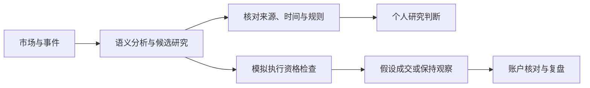

# 系统与功能

## 用途

V7 为 A 股信息研究提供统一工作台，连接市场与事件信息、策略条件、模型候选、模拟账户和复盘记录。主要任务是核对“发生了什么、依据是什么、规则是否满足、哪些条件仍缺失”，并保留后续结果。

实时运行栈与公开预览有不同的启动条件。公开预览保留组件和接口形态，使用显式合成数据、极小历史样本或无数据状态，不具备正式赛季的完整输入。

## 业务流程

人工查看研究结论与自动模拟流程并存。现有工作台不意味着每笔模拟成交都经过逐笔人工批准。

## 功能模块

| 模块 | 输入 | 输出 | 约束 |
|---|---|---|---|
| 市场环境 | 行情、市场指标和记录时间 | 市场状态与图表 | 区分实际记录、模型预测和缺失数据 |
| 新闻与事件 | 新闻正文、来源、时间及上下文 | 事件类型、相关证券、多视角解释和引用 | 引用需命中原文；内容校验失败可弃用观点 |
| 策略候选 | 策略合同、行情和证据 | 动作、触发条件、未满足条件和计划 | 证据不足或策略停用时不形成有效买入信号 |
| AI Quant | 历史输入、特征、模型及校准器 | 截面排序、风险收益估计和交易计划 | 新开仓需要合格历史与模型输入 |
| 模拟账户 | 合格计划、当前报价和账户 | 订单、成交、持仓及权益 | 执行市场时段、T+1、整手、费用及安全检查 |
| 运行与恢复 | 数据、作业、账本和对账状态 | 业务健康、限制原因与恢复状态 | 区分进程存活、业务完成及数据有效性 |
| 研究与复盘 | 决策、成交和研究输出 | 报告、跟踪状态与归因 | 历史代理、模拟结果与合格 Forward 分开解释 |

## 策略与账户

系统有五个规则/角色收益账户和一个独立 AI Quant 收益账户，风险观察角色不交易、不参与收益排名。新闻分析中的 AI-Alpha 规则角色与 AI Quant 机器学习账户是两个对象。

新闻多视角目前主要通过一次 LLM 请求产生六份输出；多个角色的相同判断不构成独立统计证据。规则扫描与模型排序有各自的输入和执行路径。

韩叔与 Cool 当前因规则口径及所需证据未完成统一而保持停用。保留页面和历史标识不代表已经启用。[当前限制](KNOWN_ISSUES.md)

## 页面组织

| 分组 | 页面 |
|---|---|
| 总览 | 总览 |
| 市场信息 | 市场环境、新闻快讯 |
| 候选研究 | 今日选股、个股分析 |
| 账户 | 竞技场、个人持仓 |
| AI 策略 | 今日 AI 策略、实战跟踪、历史表现、计划记录（二级入口） |
| 系统与数据 | 数据源状态、LLM 配置、企业微信、系统健康、基础设置、数据中心、报告审计 |

18 个页面共享展示组件。个人持仓是独立观察记录，不与模拟账户账本合并。

## 状态语义

- `HOLD`：相应动作因必要状态或证据受限而暂停，需结合原因字段解释。
- `NO_SIGNAL`：当前未形成有效策略信号，可能涉及条件未满足、证据缺失或策略停用。
- `stale`：数据超过对应消费场景的有效时限；展示缓存不能自动成为执行报价。
- 不可用：输入不存在或无法可信读取；未知权益不能用零替代。

这些状态与“判断看空”或“没有市场机会”含义不同。详细技术原因通过 API、系统状态及审计记录提供。

## 使用边界

观点不直接授予执行资格，计划不等于成交。LLM 负责解释非结构化文本；资金、交易限制、费用和账本使用确定性逻辑。系统不连接实盘下单。

公开界面数值用于展示组件；历史回放用于核对规则。二者均不能评价模型预测、盘中流动性或策略盈利能力。
