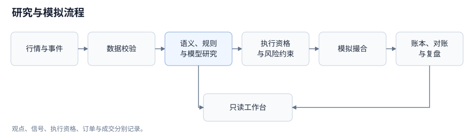

# 知策：系统与功能

知策是面向 A 股研究的 AI 投研与策略实验工作台。它连接市场信息、策略判断、投资资料与模拟结果，让使用者能够逐步核对：发生了什么、依据是什么、规则是否满足、模拟执行之后结果如何。

## 按任务使用

| 任务 | 从哪里开始 | 主要操作 | 输出 |
|---|---|---|---|
| 了解市场 | 总览、市场环境 | 查看走势、市场状态、风险与数据时间 | 当日关注事项与需要补查的输入 |
| 研究新闻 | 新闻快讯 | 阅读来源与正文，比较策略视角 | 新闻解释、相关线索与引用依据 |
| 核对候选 | 今日选股、个股分析 | 查看触发条件、未满足项和候选详情 | 可继续研究的标的与限制原因 |
| 试验投资方法 | 博主实验室 | 导入文稿、核对知识、确认规则、筛选与回放 | 分身知识、策略版本及独立实验账户 |
| 跟踪结果 | 竞技场、AI 策略、报告审计 | 查看成交、费用、持仓、计划与研究记录 | 模拟结果、执行差异与复盘资料 |

## 博主实验室

实验室已集成到主工作台导航，无需另开独立应用。它提供以下连续操作：

1. **分身与资料导入**：新增研究分身，按批次上传 TXT、Markdown、DOCX 文稿，查看解析和分块结果。
2. **全文提炼监控**：跟踪分块处理进度，查看原则、入场、退出、仓位与疑问等知识；可点开原文切片核对。
3. **知识与策略确认**：将支持的知识映射为有限规则草案，补充待确认参数，发布不可变策略版本。
4. **今日机会与证据**：当前界面按指定历史日的日终证据回放扫描，输出候选及逐条件结果，不把回放候选冒称今日实时推荐。
5. **受控回放与模拟账户**：将候选带入服务端受控场景，查看买入、同日 T+1 拦截、下一交易日卖出以及独立账本。

“分身”是资料、知识与规则的研究容器，不表示训练了一个新模型或完整复刻某位博主。提炼需要真实模型连接；不明确的思想不自动补全为可执行规则。[详细操作与运行指南](BLOGGER_LAB.md)

## 工作台研究流程

市场与新闻提供研究背景；规则策略按合同评估条件；AI Quant 通过独立模型链路提供排序、估计与计划。使用者可以查看依据和后续模拟结果。

新闻多视角目前主要通过一次 LLM 请求产生六份输出；角色判断相同不代表独立统计证据。AI-Alpha 规则角色与 AI Quant 机器学习账户是不同对象。

系统包含五个规则/角色收益账户、一个 AI Quant 收益账户；风险观察角色不交易、不参与收益排名。某韩与某库因规则口径和所需证据未统一而保持停用。实验室账户另行隔离，不加入上述排名。

## 页面组织

| 分组 | 页面与入口 |
|---|---|
| 总览 | 今日总览 |
| 市场信息 | 市场环境、新闻快讯 |
| 候选研究 | 今日选股、个股分析 |
| 账户 | 竞技场、个人持仓 |
| AI 策略 | 今日 AI 策略、实战跟踪、历史表现、计划记录（二级入口） |
| 策略实验 | 博主实验室，内含五步工作区 |
| 系统与数据 | 数据源状态、LLM 配置、企业微信、系统健康、基础设置、数据中心、报告审计 |

原有页面与博主实验室共享导航。个人持仓是独立观察记录，不与模拟账户账本合并。

## 结果如何解释

| 结果或状态 | 含义 |
|---|---|
| 观点 | 对新闻或事件的解释，需要结合原文判断 |
| 候选 / 计划 | 满足某些规则的研究结果或交易意图，尚不等于成交 |
| 成交 / 账户 | 按指定模拟规则形成的记录与账户投影 |
| HOLD | 必要条件或证据受限，应结合原因查看 |
| NO_SIGNAL | 未形成有效信号，可能是条件不满足、证据缺失或策略停用 |
| stale / 不可用 | 数据过期或无法可信读取，不能直接用于执行 |

人工研究与自动模拟流程并存，现有工作台不表示每笔原有模拟成交均经逐笔人工批准。实验室在策略版本发布前要求人工确认。

## 体验与实际运行

默认 `/demo` 展示明确标注的合成界面，包括实验室五步样例；`/replay` 运行极小历史样本的假设撮合；`/v7` 保留实际输入缺失状态。实验室默认关闭，显式启用后可在 `/v7#page-blogger-lab` 导入自己的资料。

公开示例不调用模型和行情，不使用生产账户。真实提炼、实际行情筛选与正式模拟运行需要各自配置和验证。LLM 负责文本语义，资金、费用、约束与账本由确定性逻辑处理；系统不连接实盘。[架构设计](ARCHITECTURE.md)
